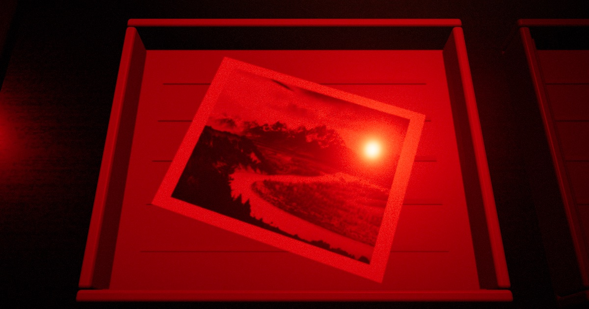
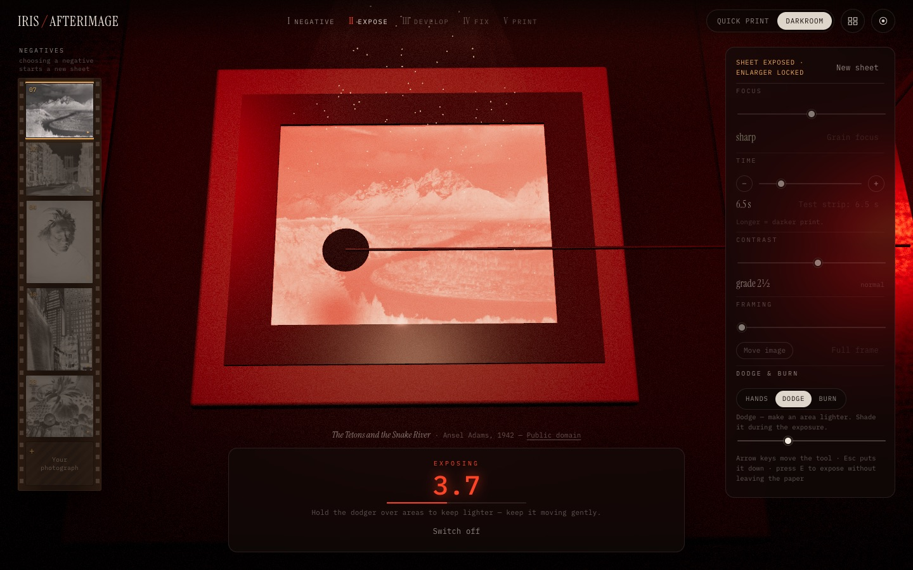
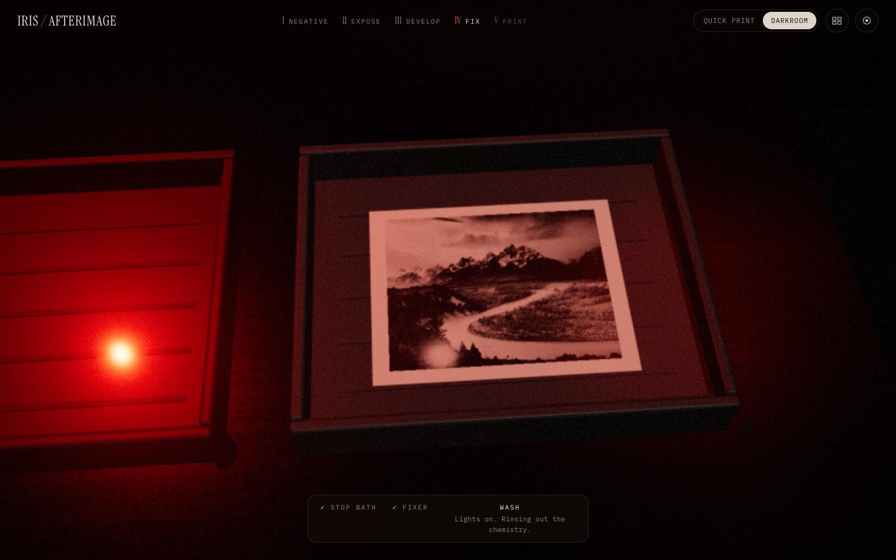
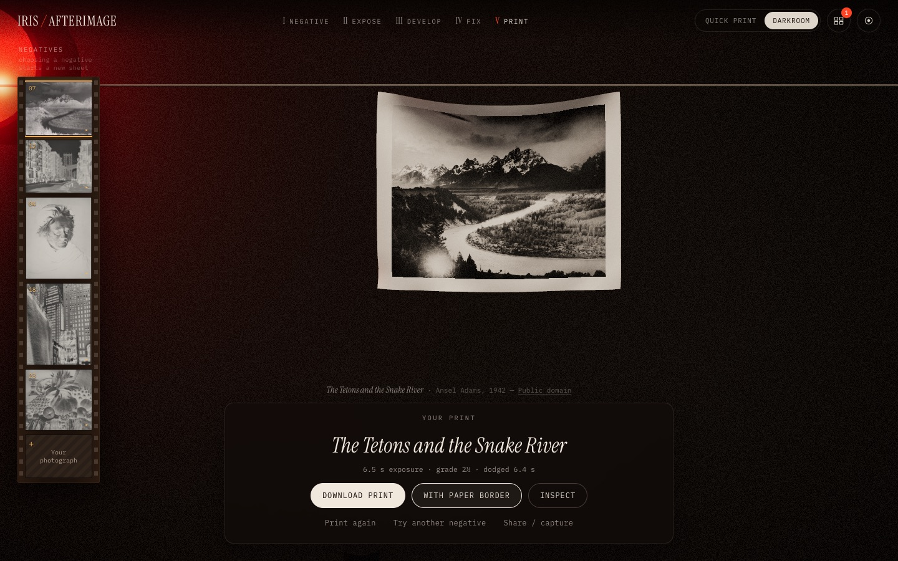

# IRIS / AFTERIMAGE

_An experiment in light, time, and memory._

An interactive black-and-white darkroom in the browser. Choose a negative,
focus the enlarger, expose a sheet of photographic paper, dodge and burn by
hand, slide it into the developer — and watch a photograph you helped make
slowly surface under the red safelight.

**Live:** https://mariaareadne1.github.io/Iris-Afterimage/



| Enlarger, dodging during the exposure | Fixed — the lights come on | Finished print on the line |
|---|---|---|
|  |  |  |

## What it does

- **A real photographic model, not filters.** The photograph becomes a film
  negative (log density, grain); the enlarger projects light through it
  (framing, focus blur); the paper accumulates exposure over time; a
  characteristic curve set by the contrast grade turns exposure into density;
  development reveals the latent image over time. Longer exposure → darker
  print. Dodging → lighter. Burning → darker. All tested on exported pixels.
  → [docs/photography-model.md](docs/photography-model.md)
- **The latent image stays invisible until the developer.** The image surfaces
  shadows first, a little unevenly unless you rock the tray.
- **Paper you can handle.** A stiff Verlet sheet (adapted from
  [Iris](https://github.com/Mariaareadne1/iris-cloth)'s cloth): pick up the exposed sheet and drop
  it in the tray, push it around in the developer, watch it get carried by
  tongs and pegged up to dry with curled edges.
- **Quick Print** (test-strip exposure, auto-focus, four clicks) and a
  **manual darkroom** (focus, time, grade 00–5, crop, dodge, burn, pulling
  early, agitation) — the same pipeline either way.
- **Your own photographs.** Import a JPEG/PNG/WebP; it stays in your browser.
  Portrait, landscape and square negatives get matching 8×10 sheets.
- **Real exports.** Download the developed print as a 2400 px PNG, or on its
  full 8×10 sheet with paper-white borders. A contact sheet collects the
  session's prints.
- **Capture.** Hide the interface, record the canvas (MP4 where the browser's
  MediaRecorder supports it, otherwise WebM), or play an automated showcase
  that runs the real workflow.

## Controls

| | |
|---|---|
| Choose a negative | film strip on the left (tap `+` to import your own) |
| Expose | **Expose** button, or **E** |
| Dodge | Darkroom → Dodge, hold the disc over the paper during the exposure (mouse, touch, or arrow keys) |
| Burn | after the main exposure: Darkroom → Burn, move the card's hole over the area, **Burn in** or **B** |
| Frame | Darkroom → Framing slider + **Move image**, then drag on the easel |
| Develop | **Into the developer**, or pick the sheet up and drop it in the DEV tray |
| Agitate | drag the tray, nudge the print, or **Rock the tray** |
| Esc | put the tool down / close dialogs |

## Run it

Node 20+:

```bash
git clone https://github.com/Mariaareadne1/Iris-Afterimage.git
cd Iris-Afterimage
npm install
npm run dev        # http://localhost:5233
```

| Script | |
|---|---|
| `npm run build` | type-check and build static files into `dist/` |
| `npm run preview` | serve the production build |
| `npm test` | unit tests (model + physics) |
| `npm run test:e2e` | Playwright browser tests (needs `npx playwright install chromium` once) |

URL options: `?mode=quick|manual` skip the intro, `?embed=1` compact embed,
`?capture=1` start with the interface hidden, `?showcase=1` play the
automated demo, `?speed=N` compress time (testing).

## Deploy

It's a static site with no backend. The included workflow
(`.github/workflows/deploy.yml`) type-checks, runs the unit tests, builds, and
publishes `dist/` to GitHub Pages on every push to `main`. The build uses
relative paths, so `dist/` also works from any sub-folder, Netlify, Vercel or
S3 — just upload it.

## Embed it in a portfolio

```html
<iframe
  src="https://mariaareadne1.github.io/Iris-Afterimage/?embed=1"
  title="Iris: Afterimage — a darkroom in the browser"
  style="width: 100%; aspect-ratio: 16 / 10; border: 0; border-radius: 12px"
  allow="fullscreen"
  loading="lazy"></iframe>
```

Embed mode keeps the darkroom interaction, hides the session extras, sizes to
the frame, and doesn't capture the parent page's scrolling.

## Use your own film

Replace the sample negatives with your scans:

1. Put JPEG/PNG/WebP files (~2000 px on the long side) in `public/negatives/`
   and remove the samples you don't want.
2. `node scripts/make-manifest.mjs --author "Your Name"` — writes
   `public/negatives/manifest.json` (titles from file names; edit freely; the
   first entry is the default).
3. Build and deploy.

## Social video

Open the capture panel (◉) → **Record the showcase**. In Chromium-based
browsers recent versions record MP4 directly; otherwise you get WebM.
Convert with `scripts/webm-to-mp4.sh recording.webm` (requires ffmpeg).

## Project docs

- [docs/photography-model.md](docs/photography-model.md): the model and its simplifications
- [docs/architecture.md](docs/architecture.md): modules, data flow, reused vs new code
- [docs/testing.md](docs/testing.md): what is tested and how
- [PROGRESS.md](PROGRESS.md): milestones, results, known issues

## Credits & license

MIT — see [LICENSE](LICENSE).

- **Iris: Afterimage** by [Maria Showalter](https://github.com/Mariaareadne1).
- Paper physics adapted from **[Iris](https://github.com/Mariaareadne1/iris-cloth)** (Maria Showalter),
  itself an adaptation of **[Holocloth](https://github.com/dmitrykurash/holocloth)** by
  [Dmitry Kurash](https://x.com/DmitryKurash), used under the MIT License.
- Sample photographs are in the public domain: Ansel Adams (NPS/NARA),
  Berenice Abbott (WPA Federal Art Project, NYPL), Julia Margaret Cameron
  (restoration by Adam Cuerden), Roger Fenton (Getty). Details in
  [public/negatives/CREDITS.md](public/negatives/CREDITS.md).
- Type: Instrument Serif and IBM Plex Mono (SIL Open Font License), via Fontsource.
- Built with [Three.js](https://threejs.org), [React](https://react.dev), [Vite](https://vite.dev).
